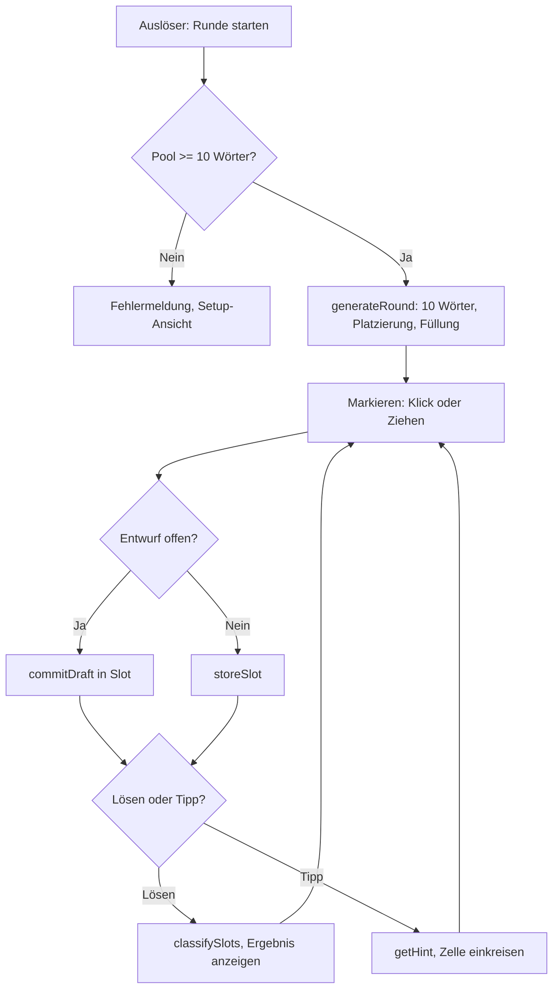

← [Zurück zur Übersicht](index.md)

# Wortsuchrätsel — Technischer Ablauf

## Übersicht

Die Seite `games/word-search/index.html` lädt die Oberfläche aus `src/word-search/main.js`. Die Spiellogik (Validierung, Generator, Klassifikation, Tipp, Geradenprüfung) liegt in `src/word-search/game.js` ohne DOM-Zugriff. Die Vokabeln werden zur Laufzeit aus `public/data/vocabulary/<niveau>.json` geladen. Die Oberfläche wird bei jedem Zustandswechsel vollständig neu gerendert.

## Ablauf

### 1. Initialisierung

`initialise()` in `main.js`:
- `loadLevels()` liest die gespeicherte Niveauauswahl aus dem Browser-Speicher (Schlüssel `mini-games.word-search.levels`). Ungültige oder leere Werte werden durch alle Niveaus ersetzt und zurückgeschrieben.
- Die sechs Vokabeldateien werden parallel über `import.meta.env.BASE_URL` und `vocabularyFile(level)` (`data/vocabulary/a1.json` …) geladen; jeder Eintrag erhält das Niveau seiner Datei.
- `validateVocabulary()` (`game.js`) prüft den Bestand, `toPuzzleWords()` bildet daraus die Gitterwörter. Bei Fehlern wird die Fehlermeldung im `#app`-Bereich angezeigt.
- `renderSetup()` zeigt die Niveau-Checkboxen, die Schwierigkeit und den Startbutton.

Beteiligte Komponenten:
- `loadLevels`, `storeLevels` — Persistenz der Niveauauswahl
- `validateVocabulary` — Schema- und Eindeutigkeitsprüfung
- `renderSetup` — Setup-Ansicht; `setupStatus` berechnet Anzahl und Sperrzustand

### 2. Rundenstart

`startRound(difficulty)` ruft `generateRound(vocabulary, selectedLevels, difficulty, rng)` auf und setzt `slots`, Entwurf und Ergebnis zurück. Ein Fehler des Generators wird als Meldung angezeigt und führt zurück zur Setup-Ansicht.

`generateRound` (`game.js`):
- Filtert die Gitterwörter nach Niveau und wählt mit `pickWords` (gemischt per `shuffle`) zehn Wörter mit unterschiedlichen deutschen Übersetzungen.
- `tryPlaceWords` platziert die Wörter, längste zuerst, über `placementCandidates` aus den zulässigen Richtungen (`directionsFor`: Einfach = `[0,1]`, `[1,0]`; Schwierig zusätzlich `[1,1]`, `[1,-1]`).
- Bis zu `MAX_GENERATION_ATTEMPTS` (120) Versuche; danach Fehler.
- Freie Zellen werden mit Zufallsbuchstaben A–Z gefüllt.

### 3. Markieren

Jede Markierung entsteht auf einem von zwei Wegen:

- **Klick:** `handleCellClick` schaltet über `toggleCell` eine Zelle im Entwurf (`state.draft.cells`) um. Mit `commitDraft` wird der Entwurf in den bearbeiteten Slot oder den ersten freien Slot übernommen (`storeSlot`).
- **Ziehen:** `handlePointerDown` merkt den Startpunkt, `handlePointerMove` zeigt die Vorschau über `showPreview`, `handlePointerUp` ruft `handleDrag` auf. `straightPath` (`game.js`) erzeugt die Zellfolge und lehnt nicht zulässige Richtungen ab. Der anschließende Klick wird über `state.suppressClick` unterdrückt.

Pro Slot wird die Zellmenge kanonisch sortiert gespeichert (`toSortedCellKeys`); die Klickreihenfolge geht verloren.

### 4. Prüfen

`solveRound()` übernimmt einen nicht leeren Entwurf zuerst (`commitDraft`). Scheitert das, etwa wegen zehn belegter Slots, bleibt der Zustand unverändert. Danach ruft es `classifySlots(slots, targets)` auf und rendert Ergebnis und Übersetzungen (`renderTranslations`, `renderResult`).

`classifySlots` ordnet jeden Slot einer Klasse zu: `empty`, `exact`, `partial`, `error` (siehe [Business Rules](business-rules.md)). Die Menge `found` enthält die IDs der gefundenen Zielwörter.

### 5. Tipp

`showHint()` blockiert bei offenem Entwurf. Sonst ruft es `getHint(slots, targets)` auf und setzt `state.hintCell`. Die Zelle wird mit der CSS-Klasse `hinted` eingekreist. Der Tipp verändert keine Slots.

### 6. Ergebnisinvalidierung

`resetResult()` setzt `solved` und `hintCell` zurück. Das geschieht bei jeder Änderung an Entwurf oder Slots (`toggleCell`, `storeSlot`, `removeSlot`, `startEditSlot`, `startDragReplace`). Gespeicherte Slots bleiben erhalten.

## Fehlerbehandlung

- Vokabeldatei nicht ladbar (`!response.ok`) oder ungültig: Fehlermeldung statt Setup.
- Zu wenige Wörter im Pool oder Generator erschöpft: `Error` mit Meldung, Rückkehr zur Setup-Ansicht.
- Browser-Speicher nicht verfügbar: `localStorage`-Zugriffe sind abgefangen; die Auswahl gilt dann nur für den Besuch.
- Keine Ausnahmen beim Markieren: ungültige Eingaben erzeugen Meldungen, keinen Zustandswechsel.

## Testzugang

Der Generator akzeptiert einen Zufallsgenerator. Über den URL-Parameter `seed` (Zahl) wird ein deterministischer Generator aktiviert (`createRandomSource` in `main.js`). Der Parameter ist für reproduzierbare Tests gedacht; im normalen Spielbetrieb ohne `seed` wird `Math.random` verwendet.
