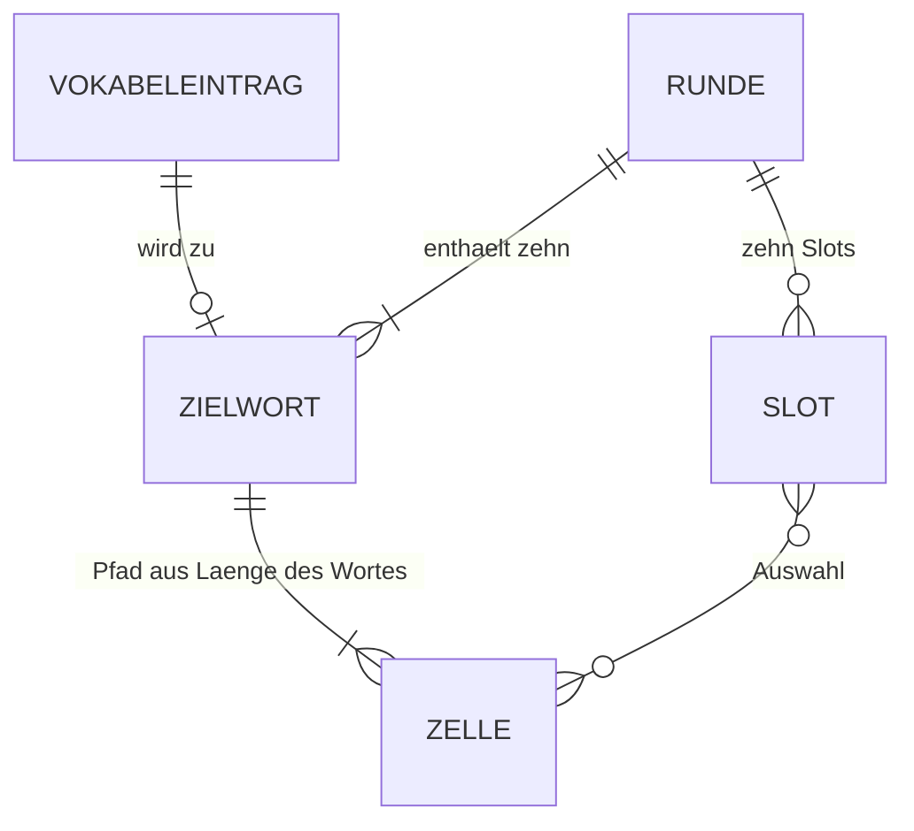

← [Zurück zur Übersicht](index.md)

# Wortsuchrätsel — Datenmodell

Das Spiel besitzt keine Datenbank. Die Vokabeln liegen als statische JSON-Datei vor, Runde und Markierungen existieren nur im Speicher der Seite. Einzig die Niveauauswahl wird im Browser-Speicher (`localStorage`) abgelegt.

## Entitäten

### Vokabeleintrag (`public/data/vocabulary.json`)

Die Datei ist ein JSON-Array. Jeder Eintrag hat folgende Eigenschaften:

| Eigenschaft | Typ | Pflicht | Beschreibung |
|-------------|-----|---------|--------------|
| `english` | string | Ja | Englisches Zielwort. Nach `trim()` und Großschreibung nur A–Z, Länge 2 bis 13. Muss eindeutig sein. |
| `german` | string | Ja | Deutsche Übersetzung, nach `trim()` nicht leer. |
| `level` | string | Ja | GER-Niveau: `A1`, `A2`, `B1`, `B2`, `C1` oder `C2`. |
| `id` | string | Nein | Stabile ID. Fehlt sie, wird `vocab-<Index>` vergeben. |

Der Bestand umfasst 61 Einträge: A1 mit 11, jeweils A2, B1, B2, C1 und C2 mit je 10 Einträgen.

Die Validierung (`validateVocabulary` in `src/word-search/game.js`) lehnt Nicht-Arrays, Nicht-Objekte, ungültige Wörter, leere Übersetzungen, unbekannte Niveaus und doppelte Wörter mit einer Meldung ab, die den Eintrag nennt.

### Runde (Laufzeit, nicht persistiert)

| Eigenschaft | Typ | Beschreibung |
|-------------|-----|--------------|
| `grid` | string[13][13] | Buchstabengitter, jede Zelle genau ein Buchstabe A–Z. |
| `difficulty` | string | `easy` oder `hard`. |
| `targets` | Zielwort[] | Genau zehn Einträge (Vokabeleintrag plus `path`). |

### Zielwort

Ein Vokabeleintrag mit `path`: eine geordnete Liste von `{ row, col }`. Ihre Länge entspricht der Länge des Wortes. Jeder Index entspricht dem Buchstaben an derselben Position.

### Markierungs-Slot (Laufzeit)

Es gibt maximal zehn Slots. Jeder Slot ist entweder leer (`null`) oder enthält eine sortierte Liste von Zellschlüsseln im Format `"row,col"`. Die Reihenfolge der Klicks wird nicht gespeichert. Der Entwurf (`draft`) enthält die offene Auswahl sowie den Bearbeitungsindex (`editingIndex`) und den Ersetzungsindex beim Ziehen (`dragReplaceIndex`).

## Beziehungen

Eine Runde enthält genau zehn Zielwörter. Jedes Zielwort stammt aus genau einem Vokabeleintrag und besitzt einen Zellpfad im Gitter. Die Slots referenzieren Zellen des Gitters, nicht Zielwörter. Die Zuordnung zu Zielwörtern erfolgt erst bei der Klassifikation.

## Persistenz

| Schlüssel | Speicherort | Inhalt |
|-----------|-------------|--------|
| `mini-games.word-search.levels` | `localStorage` | JSON-Array mit Niveau-Strings, z. B. `["A1","B2"]` |

Ungültige Werte (kein Array, leeres Array, unbekannte Niveaus oder fehlerhaftes JSON) führen zum Zurücksetzen auf alle Niveaus.

## Diagramm

