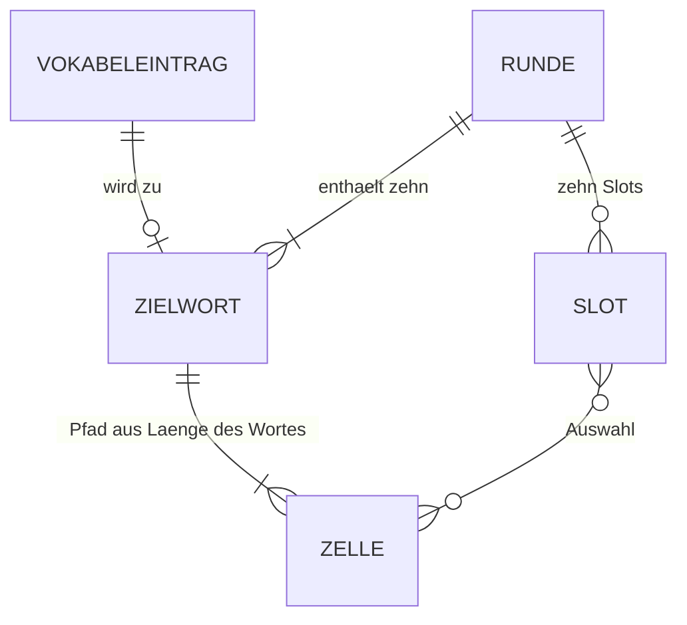

← [Zurück zur Übersicht](index.md)

# Wortsuchrätsel — Datenmodell

Das Spiel besitzt keine Datenbank. Die Vokabeln liegen als statische JSON-Dateien (eine je Niveau) vor, Runde und Markierungen existieren nur im Speicher der Seite. Einzig die Niveauauswahl wird im Browser-Speicher (`localStorage`) abgelegt.

## Entitäten

### Vokabeleintrag (`public/data/vocabulary/<niveau>.json`)

Je GER-Niveau gibt es eine Datei (`a1.json` … `c2.json`) mit einem JSON-Array. Jeder Eintrag hat folgende Eigenschaften:

| Eigenschaft | Typ | Pflicht | Beschreibung |
|-------------|-----|---------|--------------|
| `english` | string | Ja | Englischer Begriff in Originalschreibweise, z. B. „apple“, „to eat“, „train station“. Eindeutig (ohne Groß-/Kleinschreibung). |
| `german` | string | Ja | Deutsche Übersetzung. |
| `partOfSpeech` | string | Ja | Wortart: `noun`, `verb`, `adjective`, `adverb`, `preposition`, `conjunction` oder `pronoun`. Verben stehen als Infinitiv mit „to“ (außer Modalverben wie „can“). |
| `topic` | string | Ja | Thema auf Deutsch, z. B. „Essen“, „Arbeit“. |
| `synonyms` | string[] | Ja | Deutsche Synonyme, ggf. leer. |
| `exampleGerman` | string | Ja | Beispielsatz auf Deutsch. |
| `exampleEnglish` | string | Ja | Derselbe Beispielsatz auf Englisch. |
| `image` | string | Nein | Symbolbild für Gegenstände und Lebewesen, Pfad relativ zu `public/`, z. B. `images/vocabulary/dog.svg`. Nur bei Substantiven. Die Bilder werden als `` angezeigt; Herkunft und Lizenzen stehen in `public/images/vocabulary/LIZENZEN.md`. |

Das Niveau steht nicht im Eintrag, sondern ergibt sich aus der Datei. Beim Laden ergänzt das Spiel `level` und eine `id` (`vocab-<Index>`).

Der Bestand umfasst 2454 Einträge: A1 118, A2 105, B1 117, B2 743, C1 1262, C2 109.

**Gitterwörter:** `toPuzzleWords` (`game.js`) bildet daraus die Wörter für das Wortsuchrätsel: Ein führendes „to“ entfällt, der Rest wird großgeschrieben und muss nur aus A–Z mit 2 bis 13 Buchstaben bestehen. Wortgruppen und Begriffe mit Bindestrich bleiben für andere Spiele im Bestand, kommen im Gitter aber nicht vor. Ergeben zwei Begriffe dasselbe Gitterwort (z. B. „present“ und „to present“), zählt der erste.

Neue Vokabeln lassen sich mit `node scripts/import-vocabulary.mjs <ordner>` aus Dateien `a1.json` … `c2.json` (Felder `Question` = deutsch, `Answer` = englisch, `PartOfSpeech`, `Topic`, `Synonyms`, `ExampleSentence`, `ExampleSentenceTranslation`) übernehmen. Neue englische Begriffe werden ihrem Niveau angehängt; ist ein Begriff schon vorhanden („to improve“ und „improve“ gelten als gleich), bleibt er in seinem Niveau und fehlende Angaben werden ergänzt. Das Skript kann beliebig oft laufen und prüft den Bestand am Ende mit `validateVocabulary`.

Die Validierung (`validateVocabulary` in `src/word-search/game.js`) lehnt Nicht-Arrays, Nicht-Objekte, ungültige Wörter, leere Übersetzungen, unbekannte Niveaus und doppelte Wörter mit einer Meldung ab, die den Eintrag nennt.

### Runde (Laufzeit, nicht persistiert)

| Eigenschaft | Typ | Beschreibung |
|-------------|-----|--------------|
| `grid` | string[13][13] | Buchstabengitter, jede Zelle genau ein Buchstabe A–Z. |
| `difficulty` | string | `easy` oder `hard`. |
| `targets` | Zielwort[] | Genau zehn Einträge (Vokabeleintrag plus `path`). |

### Zielwort

Ein Vokabeleintrag mit `path`: eine geordnete Liste von `{ row, col }`. Ihre Länge entspricht der Länge des Wortes. Jeder Index entspricht dem Buchstaben an derselben Position.

### Markierungs-Slot (Laufzeit)

Es gibt maximal zehn Slots. Jeder Slot ist entweder leer (`null`) oder enthält eine sortierte Liste von Zellschlüsseln im Format `"row,col"`. Die Reihenfolge der Klicks wird nicht gespeichert. Der Entwurf (`draft`) enthält die offene Auswahl sowie den Bearbeitungsindex (`editingIndex`) und den Ersetzungsindex beim Ziehen (`dragReplaceIndex`).

## Beziehungen

Eine Runde enthält genau zehn Zielwörter. Jedes Zielwort stammt aus genau einem Vokabeleintrag und besitzt einen Zellpfad im Gitter. Die Slots referenzieren Zellen des Gitters, nicht Zielwörter. Die Zuordnung zu Zielwörtern erfolgt erst bei der Klassifikation.

## Persistenz

| Schlüssel | Speicherort | Inhalt |
|-----------|-------------|--------|
| `mini-games.word-search.levels` | `localStorage` | JSON-Array mit Niveau-Strings, z. B. `["A1","B2"]` |

Ungültige Werte (kein Array, leeres Array, unbekannte Niveaus oder fehlerhaftes JSON) führen zum Zurücksetzen auf alle Niveaus.

## Diagramm

